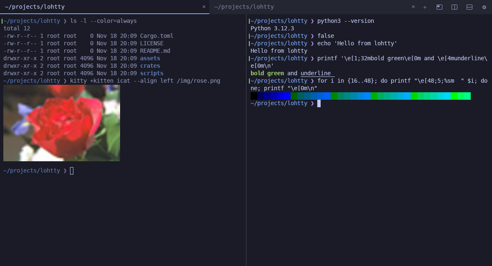

# lohtty

A fast, GPU-accelerated terminal for Windows, made for working with coding
agents such as Claude Code and Codex. It also runs on macOS and Linux.
Written in Rust with [gpui](https://gpui.rs) and
[alacritty_terminal](https://github.com/alacritty/alacritty).



- **Coding agents:** each agent's status on its tab (working, waiting for
  you, done, failed), alerts when one needs you, Claude and Codex usage limits
  in the title bar, and a Shift+Enter that reaches the agent.
- **Tabs and splits in the title bar,** like Windows Terminal, with pane zoom
  and a command palette.
- **Shell integration:** jump from prompt to prompt, copy a command's output
  in one key, see which commands failed.
- **Images and animations** through the kitty graphics protocol.
- **Record a pane to asciinema** from the command palette.
- **Quick to type in:** about 7 ms from key press to screen on Windows, on a
  par with Windows Terminal.

## Contents

- [Features](#features)
- [Install](#install)
- [Build from source](#build-from-source)
- [Configuration](#configuration)
- [Shell integration](#shell-integration)
- [Recording (asciinema)](#recording-asciinema)
- [Coding agents](#coding-agents)
- [Keyboard shortcuts and mouse](#keyboard-shortcuts-and-mouse)
- [Troubleshooting](#troubleshooting)
- [Project status](#project-status)
- [Contributing](#contributing)
- [Acknowledgments](#acknowledgments)
- [License](#license)

## Features

**Terminal**
- xterm-compatible, UTF-8, wide (CJK) characters and emoji
- Kitty keyboard protocol, so Shift+Enter and other modified keys reach
  programs
- Mouse selection (rectangles too), clipboard, bracketed paste, mouse
  reporting for terminal apps, OSC 8 hyperlinks
- Search: literal or regex, case toggle, highlighted matches
- Images through the kitty graphics protocol: PNG and raw RGB/RGBA; direct,
  file, temporary-file and shared-memory transfer; Unicode placeholders, so
  images work inside tmux; animations, so `kitty icat` plays a GIF

**Windows and panes**
- Tabs in the title bar (lohtty draws its own on Linux too), split panes,
  pane zoom
- New tabs and splits start in the active pane's directory
- While the shell waits at its prompt, the tab shows its directory (`~` for
  home); a running program shows its own title
- Panes without the focus are faded, so the active one stands out
- A command palette (Ctrl+Shift+P) lists every action with its shortcut

**Look**
- Themes (Tokyo Night by default) with live config reload, and a Settings
  dialog
- Background opacity and blur
- Ligatures, and Nerd Font icons through font fallbacks
- Box-drawing, block and Powerline characters drawn to join across cells,
  whatever the font
- Per-pane font zoom (Ctrl+= / Ctrl+-)

**Shell and agents**
- [Shell integration](#shell-integration) (OSC 133): a green or red mark
  beside each command, prompt-to-prompt jumps, copy the last output
- [Recording](#recording-asciinema) to asciinema files
- [Coding agents](#coding-agents): session status (OSC 7501), progress
  (OSC 9;4, also on the Windows taskbar), attention alerts and desktop
  notifications, Claude and Codex usage limits
- PowerShell by default on Windows, any shell configurable

## Install

Download a build from the [releases page](https://github.com/leoncx/lohtty/releases).

### Windows

Tested on Windows 11. x64 and ARM64 builds (the ARM64 one isn't tested on
ARM hardware yet).

- **Installer:** `lohtty-<version>-windows-x64.msi` (or `-arm64.msi`). It
  installs for the current user only, in `%LOCALAPPDATA%\Programs\lohtty`,
  without admin rights, and adds a Start menu shortcut. Newer versions
  upgrade in place; uninstall from *Settings → Apps*.
- **Portable:** `lohtty-<version>-windows-x64.zip` (or `-arm64.zip`): unzip
  it and run `lohtty.exe`.

### macOS

macOS 11 or later, Apple Silicon or Intel. Open
`lohtty-<version>-macos-universal.dmg` and drag *lohtty* to *Applications*.

### Linux

x86_64, glibc 2.35 or later (Ubuntu 22.04, Debian 12, Fedora 36 and newer),
and a Vulkan driver.

- **AppImage:** `lohtty-<version>-linux-x86_64.AppImage`: `chmod +x` it and
  run it. It needs FUSE (most desktops have it); without it, run it with
  `--appimage-extract-and-run`.
- **Tarball:** `lohtty-<version>-linux-x86_64.tar.gz` holds the binary, a
  `.desktop` entry and the icon. It uses the system's `libxkbcommon` and
  `libxkbcommon-x11`, which the AppImage bundles. To add it to your menus:

  ```sh
  install -Dm755 lohtty ~/.local/bin/lohtty
  install -Dm644 lohtty.desktop ~/.local/share/applications/lohtty.desktop
  install -Dm644 lohtty.png ~/.local/share/icons/hicolor/256x256/apps/lohtty.png
  ```

### Unsigned releases

Releases aren't code-signed or notarized yet, so your system warns the
first time:

- **Windows:** SmartScreen shows *Windows protected your PC*: click **More
  info → Run anyway**. The installer shows the publisher as *Unknown*. For
  the zip, you can clear the download mark before extracting
  (*Properties → Unblock*, or `Unblock-File .\lohtty-<version>-windows-x64.zip`).
- **macOS:** the first launch is blocked: open *System Settings → Privacy &
  Security* and click **Open Anyway** (on macOS 14 and earlier, right-click
  the app and choose **Open**), or run
  `xattr -dr com.apple.quarantine /Applications/lohtty.app`.

Each release lists the SHA-256 of its files in `SHA256SUMS`. To check a
download:

```sh
sha256sum -c SHA256SUMS --ignore-missing          # Linux
shasum -a 256 -c SHA256SUMS --ignore-missing      # macOS
```

```powershell
Get-FileHash .\lohtty-<version>-windows-x64.msi -Algorithm SHA256   # Windows
```

## Build from source

[rustup](https://rustup.rs) installs the Rust version pinned in
`rust-toolchain.toml`.

```sh
cargo build --release                         # target/release/lohtty(.exe)
cargo build --release --no-default-features   # without kitty graphics
```

**Windows.** lohtty runs shells through Microsoft's ConPTY (`conpty.dll`
and `OpenConsole.exe`, from the Windows Terminal project), shipped next to
`lohtty.exe`: the copy built into Windows can drop sequences it doesn't
know, such as kitty graphics, so images wouldn't show. Put it next to your
build once (it is downloaded from nuget.org, checked against a pinned hash
and Microsoft's signature):

```powershell
pwsh -File scripts/conpty.ps1 -Dest target\debug,target\release
```

Without it, lohtty uses Windows' ConPTY and works, except for images.
`scripts/package.ps1 [-Msi]` builds the zip (and the installer, with WiX 5).

**Linux.** Install the development packages first (names for Debian and
Ubuntu); `scripts/package-linux.sh [--appimage]` builds the tarball and the
AppImage:

```sh
sudo apt install build-essential pkg-config libxkbcommon-dev libxkbcommon-x11-dev \
  libwayland-dev libvulkan-dev libx11-xcb-dev libxcb1-dev libfontconfig-dev libssl-dev
```

**macOS.** Building needs Xcode, not just the Command Line Tools (gpui
compiles its Metal shaders with it). `scripts/package-macos.sh` builds the
universal app and its disk image.

## Configuration

The config file is `%APPDATA%\lohtty\config.toml` on Windows,
`~/Library/Application Support/lohtty/config.toml` on macOS and
`$XDG_CONFIG_HOME/lohtty/config.toml` (usually `~/.config/lohtty`) on
Linux. Every key is optional. Changes apply as soon as the file is saved,
except `shell`, which only affects new tabs and panes. If the file is
invalid, lohtty keeps the previous settings and shows a red error bar. To use
another file (a portable setup, a test), set `LOHTTY_CONFIG` to its path.

The **Settings** dialog (the gear button, or Ctrl+, / Cmd+,) edits the
common options. Saving updates `config.toml` in place, keeping your comments
and other settings.

```toml
theme = "tokyo-night"      # tokyo-night, tokyo-night-storm, tokyo-night-moon, tokyo-night-day
scrollback = 10000
copy_on_select = false     # copy mouse selections to the clipboard right away

[shell]
program = "pwsh.exe"       # default: pwsh.exe, else powershell.exe; $SHELL elsewhere
                           # (a login shell on macOS)
args = ["-NoLogo"]

[font]
family = "Cascadia Code"   # default; Menlo on macOS, the first installed common monospace font on Linux
size = 14.0
ligatures = true
# Fonts used for characters the main font lacks (e.g. Nerd Font icons).
# Default: whichever common Nerd Fonts are installed.
fallbacks = ["Symbols Nerd Font Mono"]

[window]
opacity = 0.92             # 1.0 = opaque
blur = true
padding = 8
width = 1000
height = 650
dim_unfocused = true       # fade the text of panes without focus

[graphics]
kitty = true               # kitty graphics protocol (new tabs and panes)

[notifications]
desktop = true             # desktop notifications when lohtty isn't in front (Windows, macOS)

[usage]
claude = true              # Claude's limits on the title bar (needs Claude Code signed in)
codex = true               # Codex's limits (from its session logs)
refresh = 120              # seconds between two checks of Claude's usage (60 at least)

[recording]
# dir = 'D:\casts'         # default: lohtty in your Videos folder
format = 3                 # asciicast version; 2 for older players
input = false              # also record what you type (passwords too!)
# idle_time_limit = 2      # longest pause kept on playback, in seconds
```

### Themes

A theme is a TOML file. Files in `<config folder>/themes/<name>.toml` are
used by name and override bundled themes with the same name:

```toml
name = "My Theme"
foreground = "#c0caf5"
background = "#1a1b26"
cursor = "#c0caf5"
selection = "#283457"
ansi = [
  "#15161e", "#f7768e", "#9ece6a", "#e0af68", "#7aa2f7", "#bb9af7", "#7dcfff", "#a9b1d6",
  "#414868", "#ff899d", "#9fe044", "#faba4a", "#8db0ff", "#c7a9ff", "#a4daff", "#c0caf5",
]
```

## Shell integration

When the shell marks its prompts and its commands' output (OSC 133, as in
other terminals), lohtty:

- puts a thin green or red bar beside each prompt whose command succeeded or
  failed (a prompt where nothing ran gets none);
- jumps between prompts with **Ctrl+Shift+Up / Down** (macOS: Cmd+Shift+Up /
  Down): the previous or next prompt comes to the top of the view, and past
  the last one, back to the bottom;
- selects and copies the last command's output with **Ctrl+Shift+O**
  (macOS: Cmd+Shift+O), scrolling up to its start if needed.

Some prompts send the marks on their own (oh-my-posh with
`"shell_integration": true`, fish 4); otherwise add one of these to your
shell's profile.

**PowerShell** (`$PROFILE`; with oh-my-posh, use its option instead):

```powershell
$global:__lohttyHistory = -1
function prompt {
    $ok = $?
    $e = [char]27
    # D: the result of the command just run, if one ran.
    $last = Get-History -Count 1
    $done = if ($last -and $last.Id -ne $global:__lohttyHistory) {
        $global:__lohttyHistory = $last.Id
        "$e]133;D;$(if ($ok) { 0 } else { 1 })$e\"
    } else { "$e]133;D$e\" }
    "$done$e]133;A$e\PS $($PWD.Path)> $e]133;B$e\"
}
Set-PSReadLineKeyHandler -Key Enter -ScriptBlock {
    [Microsoft.PowerShell.PSConsoleReadLine]::AcceptLine()
    [Console]::Write("$([char]27)]133;C$([char]27)\")
}
```

**bash** (`~/.bashrc`, after `PS1` is set):

```sh
PS0=$'\e]133;C\e\\'
PROMPT_COMMAND='printf "\e]133;D;%s\e\\\\" "$?"'"${PROMPT_COMMAND:+; $PROMPT_COMMAND}"
PS1='\[\e]133;A\e\\\]'"$PS1"'\[\e]133;B\e\\\]'
```

The marks are invisible characters lohtty adds to the first character of
each prompt and output, so they scroll with the text and go when it is
cleared; they aren't copied.

## Recording (asciinema)

lohtty records a pane to an [asciinema](https://asciinema.org) file
(`.cast`), without `asciinema rec`. Open the command palette
(Ctrl+Shift+P) and choose **Start recording this pane**; the tab shows a
red dot while it records. Choose **Stop recording this pane** to finish, or
exit the shell. A message gives the file's path: by default
`lohtty-<date>-<time>.cast` in a `lohtty` folder in your Videos folder
(`recording.dir` changes it).

- The recording starts from the screen as it is, so players don't begin on
  a blank screen.
- Each shell prompt is a marker, so players can jump command by command,
  when the shell sends prompt marks (see [Shell integration](#shell-integration)).
- The theme's colors are stored with it; resizes and the shell's exit code
  are recorded too.
- What you type isn't recorded unless `recording.input = true`; output
  still shows what the shell echoes.

Play it with `asciinema play <file>`, or share it with `asciinema upload`.
The default format is asciicast v3 (asciinema 3); set `recording.format = 2`
for older players.

## Coding agents

### Attention alerts

When a program rings the bell or asks for a notification (OSC 9, OSC 777 or
OSC 99), lohtty lets you know, unless you're already looking at that pane:

- The tab gets a yellow dot until you visit the pane. On macOS, the Dock icon
  also shows how many panes are waiting.
- If lohtty isn't in front, its taskbar button flashes (Windows) or its Dock
  icon bounces (macOS), and a desktop notification shows the message.
  Clicking it brings you to that tab and pane. Each pane shows at most one
  notification every 5 seconds. Turn them off with
  `notifications.desktop = false`. On macOS, the first one asks whether
  lohtty may send notifications, and only the app (`lohtty.app`) can send
  them, not a bare `cargo run` build.

Coding agents use this to say they finished or wait for you, but most only
send it to terminals they recognize. To turn it on:

- **Claude Code:** in `~/.claude/settings.json`, set
  `"preferredNotifChannel": "iterm2"` (sends the message), or
  `"terminal_bell"` (bell only).
- **Codex:** in `~/.codex/config.toml`:

  ```toml
  [tui]
  notifications = true
  notification_method = "osc9"
  ```

- **Other tools:** anything that sends OSC 9 (iTerm2's form), OSC 777
  `notify` or OSC 99 (kitty's), or rings the bell.

### Session status and progress

Programs that report their state with the Program Status Protocol
(OSC 7501), such as Claude Code 2.1.295 and later, show it on their tab: a
spinner while working (with the progress, if any), `!` when waiting for you
(a permission, a question, a sign-in), ✓ when done and ✕ on error. The
tooltip has the program's message. Done and error clear when you visit the
pane. A program that becomes blocked, done or failed in a pane you aren't
looking at also triggers the alerts above. Nothing needs to be turned on.

Programs that report progress the Windows Terminal way (OSC 9;4), such as
winget or PowerShell's `Write-Progress` with
`$PSStyle.Progress.UseOSCIndicator = $true`, get the same tab spinner and
percentage. On Windows, the taskbar button shows the most urgent status of
all tabs: a progress bar, a busy marquee, yellow when a program waits for
you, red on error.

### Usage limits

On the right of the title bar, a donut per agent shows how much of your
plan's limits is used: the outer ring is the current 5-hour session, the
inner ring the week. They turn yellow from 70 % and red from 90 %. Hovering
shows each window's use and the time left until it resets; clicking checks
again. An agent shows only once it is set up on the machine:

- **Claude:** lohtty reads Claude Code's sign-in on your machine
  (`~/.claude/.credentials.json`, or the Keychain on macOS) and asks the same
  usage service as Claude Code's `/usage`, every 2 minutes. It only reads:
  it never renews the sign-in, and if it has expired, the tooltip says so
  until you run Claude Code again. This service isn't documented by
  Anthropic and may change.
- **Codex:** read from Codex's session logs (`~/.codex/sessions`), which hold
  the limits as of Codex's last answer, so they don't update while Codex isn't
  running.

Turn either off in Settings, or with `usage.claude` / `usage.codex`.

### Shift+Enter

Shift+Enter inserts a new line in agents' prompts instead of sending them.
lohtty supports the kitty keyboard protocol (the level programs use to tell
modified keys apart), and on Windows it also sends modified Enter the way
Windows Terminal does, so programs that read console key events (Codex) see
the Shift. Programs that use neither still get a plain Enter: use Ctrl+J, or
`\` then Enter, in Claude Code.

## Keyboard shortcuts and mouse

The Windows and Linux shortcuts. On macOS, Cmd replaces Ctrl+Shift for copy,
paste, search and tabs. The command palette (Ctrl+Shift+P) lists them all.

| Action | Shortcut |
|---|---|
| Command palette | Ctrl+Shift+P (macOS: Cmd+Shift+P) |
| Copy / paste | Ctrl+Shift+C / Ctrl+Shift+V (also Ctrl+Insert / Shift+Insert) |
| Select a rectangle | Alt+drag (macOS: Option+drag) |
| Paste the last selection (Linux) | Middle click |
| Search | Ctrl+Shift+F |
| Next / previous match (in search) | Enter / Shift+Enter |
| Close search | Esc |
| Previous / next prompt | Ctrl+Shift+Up / Ctrl+Shift+Down (macOS: Cmd+Shift+Up / Down) |
| Select and copy the last command's output | Ctrl+Shift+O (macOS: Cmd+Shift+O) |
| Larger / smaller / default text (this pane) | Ctrl+= / Ctrl+- / Ctrl+0, or Ctrl+mouse wheel (macOS: Cmd+= / Cmd+- / Cmd+0) |
| New tab | Ctrl+Shift+T |
| Next / previous tab | Ctrl+Tab / Ctrl+Shift+Tab |
| Go to tab 1–9 | Ctrl+Alt+1 … 9 (9 = last tab) |
| Split right / split down | Alt+Shift+= / Alt+Shift+- |
| Move focus between panes | Alt+Arrow, or Ctrl+Alt+Arrow (macOS: Cmd+Option+Arrow) |
| Zoom the pane (fill the tab) / show all panes | Ctrl+Shift+Z (macOS: Cmd+Shift+Enter) |
| Close pane | Ctrl+Shift+W |
| Settings | Ctrl+, (macOS: Cmd+,) |
| Word left / right, delete the next word (macOS, in the shell) | Option+Left / Option+Right, Option+Fn+Delete |

Mouse:
- Drag to select. Double-click selects a word, triple-click a line.
- Right-click copies the selection, or pastes if nothing is selected.
- Ctrl+click opens a hyperlink.
- Middle-click on a tab closes it.
- Drag a divider to resize panes.
- With split panes, the zoom button on the title bar shows the active pane
  alone; click it again to show all panes.
- Shift+drag selects text even when an app captures the mouse.

## Troubleshooting

- **Alt+Arrow doesn't move between panes.** A window manager such as GlazeWM
  may capture Alt+Arrow globally. Use Ctrl+Alt+Arrow instead.
- **No colors in PowerShell or prompts.** Check whether `NO_COLOR` is set in
  your environment. lohtty passes the environment through unchanged.
- **Prompt icons show as boxes.** Install a Nerd Font (for example
  *Symbols Nerd Font Mono*) or list one in `font.fallbacks`.
- **New tabs start in the home directory, and the title shows no directory
  (Windows).** lohtty can't read another process's directory on Windows, so
  the shell must report it with OSC 9;9 or OSC 7. With oh-my-posh, add
  `pwd: osc99` at the top of its config. In plain PowerShell, add to your
  profile:

  ```powershell
  function prompt {
    $loc = $executionContext.SessionState.Path.CurrentLocation
    $osc = if ($loc.Provider.Name -eq 'FileSystem') { "`e]9;9;`"$($loc.ProviderPath)`"`e\" }
    "$osc" + "PS $loc$('>' * ($nestedPromptLevel + 1)) "
  }
  ```

  On macOS and Linux it works without setup. A shell that sends OSC 7 keeps
  symbolic links in the path (`/tmp` rather than `/private/tmp`).
- **Italic text shows upright (Linux, macOS).** The font has no italic face:
  lohtty can't slant it there (Windows does). Use a font that ships italics,
  such as JetBrains Mono, Fira Code, Cascadia Code, or DejaVu Sans Mono with
  its Oblique files (`fonts-dejavu-extra` on Debian and Ubuntu).
- **Images don't show.** Programs detect kitty graphics by sending a query,
  which lohtty answers unless `graphics.kitty = false`. On Windows, images
  need the ConPTY that ships with lohtty (`conpty.dll` and `OpenConsole.exe`
  next to `lohtty.exe`): the packages include it, and builds from source get
  it with `scripts/conpty.ps1` (see [Build from source](#build-from-source)).
- **Images in tmux.** Programs such as `kitty icat` draw images through
  Unicode placeholders inside tmux. tmux must pass the graphics commands
  through and keep 24-bit colors (the image id travels in the text color):

  ```
  set -g allow-passthrough on
  set -as terminal-features ",xterm-256color:RGB"
  ```

  Programs that wait for the terminal's reply to decide (yazi) don't get it
  through tmux, and don't recognize lohtty by name, so they show no images
  there.
- **Black or missing window on Linux.** lohtty draws with Vulkan: check that
  a Vulkan driver is installed (`vulkaninfo --summary`, from `vulkan-tools`).
- **Logs.** Set `LOHTTY_LOG=debug` (or `lohtty_term::pty=trace` for raw
  shell output) and start lohtty from another terminal. Logs go to stderr.

## Project status

lohtty is young (0.x) and used daily on Windows, its main platform. The
macOS and Linux builds work and are tested, but see less day-to-day use:
expect rough edges there. Settings, shortcuts and the config file may still
change between versions; the [changelog](CHANGELOG.md) says what changed.

## Contributing

Bug reports and ideas are welcome in the issues. Please include your OS,
lohtty's version (Settings → About) and, for display problems, a screenshot.

For pull requests:
- `PLAN.md` describes the architecture and how each feature works, with what
  was tested; `SPEC.md` is the original specification.
- Before submitting, run:

  ```sh
  cargo fmt --all
  cargo clippy --workspace --all-targets -- -D warnings
  cargo clippy -p lohtty --no-default-features --all-targets -- -D warnings
  cargo test --workspace
  ```

- Changes visible to users go in `CHANGELOG.md` under **Unreleased**, and in
  this README when they need explaining.

## Acknowledgments

lohtty builds on [gpui](https://gpui.rs) (Zed's UI framework),
[alacritty_terminal](https://github.com/alacritty/alacritty) (the terminal
engine) and [portable-pty](https://github.com/wezterm/wezterm) (from
WezTerm). It follows protocols and conventions from
[kitty](https://sw.kovidgoyal.net/kitty/) (graphics and keyboard),
[Windows Terminal](https://github.com/microsoft/terminal) (whose ConPTY it
ships), iTerm2, [asciinema](https://asciinema.org) and the Program Status
Protocol. The default theme is
[Tokyo Night](https://github.com/enkia/tokyo-night-vscode-theme).

## License

Licensed under the [Apache License, Version 2.0](LICENSE). The Windows
packages also include Microsoft's ConPTY, under the MIT License (see
[THIRD-PARTY-NOTICES.md](THIRD-PARTY-NOTICES.md)).
